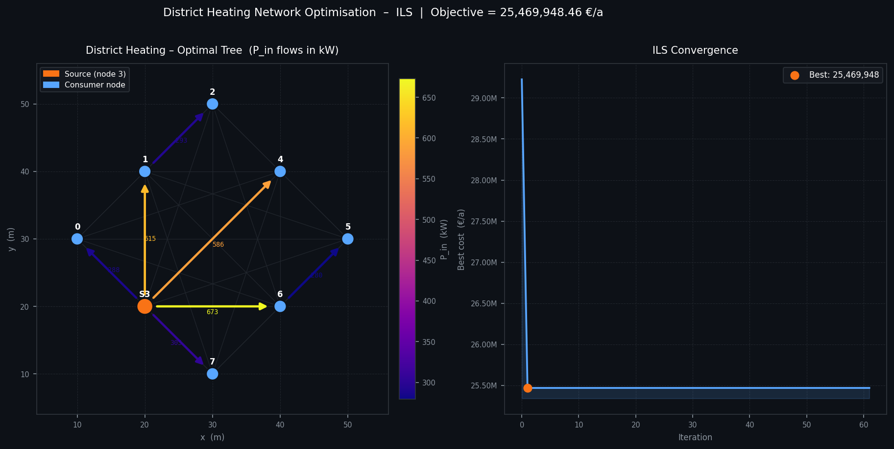

# Optimisation d'un réseau de chaleur urbain (District Heating)

Ce projet conçoit un réseau de chaleur urbain à coût minimal. Il part d'une source de chaleur et d'un ensemble de nœuds consommateurs, puis choisit **quelles conduites construire** et **dans quel sens la chaleur y circule**. L'objectif est de minimiser les dépenses annuelles totales (investissement, exploitation, production de chaleur et pénalités de demande non satisfaite, moins les recettes de vente).

Deux approches complémentaires sont implémentées :

| Fichier | Méthode | Données lues | Rôle |
|---|---|---|---|
| [ILP.py](ILP.py) | Programmation linéaire en nombres entiers (PuLP + CBC) | `.xlsx` | Solution **optimale exacte** |
| [ILS.py](ILS.py) | Métaheuristique *Iterated Local Search* | `.json` | Bonne solution **rapide**, adaptée aux grandes instances |

Projet réalisé dans le cadre du cours *Networked Systems / Recherche Opérationnelle* à l'IMT Atlantique.



---

## Le problème

On travaille sur un graphe complet orienté de `N` nœuds, dont l'un est la source. Il faut sélectionner `N − 1` arcs qui forment un **arbre couvrant orienté enraciné à la source**.

### Variables de décision (modèle ILP)

- `X[i,j] ∈ {0,1}` : la conduite `i → j` est construite ou non
- `P_in[i,j] ≥ 0` : puissance thermique qui entre dans la conduite (kW)
- `P_out[i,j] ≥ 0` : puissance thermique qui en sort (kW)

### Fonction objectif (€/an, à minimiser)

```
Z =  Coût de production de chaleur     Σ P_in[source,j] · T_flh · c_heat[source] / β
   + Maintenance                       Σ X[i,j] · l[i,j] · c_om[i,j]
   + Investissement fixe (annualisé)   α · Σ X[i,j] · l[i,j] · c_fix
   + Investissement variable           α · Σ P_in[i,j] · l[i,j] · c_var[i,j]
   + Pénalité de demande non servie    Σ (1 − X[i,j] − X[j,i]) · D[i,j] · p_umd[i,j]
   − Recettes                          Σ X[i,j] · D[i,j] · λ · c_rev[i,j]
```

`l[i,j]` est la distance euclidienne entre les nœuds, calculée à partir de leurs coordonnées.

### Contraintes

1. **Structure d'arbre** : exactement `N − 1` arcs, et chaque nœud hors source a au moins un arc entrant.
2. **Unidirectionnalité** : `X[i,j] + X[j,i] ≤ 1`.
3. **Bilan thermique avec pertes** sur chaque conduite :
   `P_out = P_in · (1 − θ_var · l) − (d · β · λ + θ_fix · l) · X`
4. **Conservation du flux** à chaque nœud hors source : ce qui entre est égal à ce qui repart.
5. **Capacité des conduites** : `P_in[i,j] ≤ C_max[i,j] · X[i,j]`.
6. **Source** : aucun flux entrant, et production totale `≤ Q_max`.

---

## Métaheuristique ILS

[ILS.py](ILS.py) suit le schéma classique de l'*Iterated Local Search* :

```
s0     ← solution gloutonne
s*     ← RechercheLocale(s0)
s_best ← s*
tant que le critère d'arrêt n'est pas atteint :
    s'  ← Perturbation(s*)          # diversification
    s*' ← RechercheLocale(s')       # intensification
    s*  ← Acceptation(s*, s*')
    mettre à jour s_best
```

- **Représentation** : une liste de `N − 1` arcs orientés `(i, j)` qui forment un arbre enraciné à la source.
- **Évaluation** : les flux sont calculés de façon exacte en remontant l'arbre des feuilles vers la source (`P_in = (besoin aval + δ) / η`). Une solution qui viole une capacité de conduite ou de source reçoit un coût `+∞`.
- **Solution initiale** : construction gloutonne de type Prim depuis la source. À chaque étape, on ajoute l'arc réalisable de plus faible coût estimé (investissement fixe + maintenance − recettes).
- **Recherche locale**, en *first improvement*, avec deux mouvements appliqués en alternance :
  - **Edge-swap** : on retire un arc de l'arbre, puis on reconnecte les deux sous-arbres par un autre arc, dans les deux sens.
  - **Réversion** : on inverse le sens d'un arc.
- **Perturbation** : on retire un arc choisi au hasard et on reconnecte avec un arc aléatoire réalisable.
- **Acceptation** : une nouvelle solution n'est acceptée que si elle améliore strictement l'optimum local courant.
- **Arrêt** : 300 itérations au maximum, ou 60 itérations consécutives sans amélioration. La graine est fixée (`seed=42`) pour que les résultats soient reproductibles.

---

## Données

| Instance | Nœuds | Source | Fichiers |
|---|---|---|---|
| Petite | 8 | nœud 4 (indexé à partir de 1), soit le nœud 3 dans le code | `InputDataEnergySmallInstance.xlsx` / `.json` |
| Grande | 30 | nœud 4 (indexé à partir de 1) | `InputDataEnergyLargeInstance.xlsx` / `.json` |

Les fichiers Excel et JSON contiennent les mêmes paramètres. Dans le classeur Excel, chaque paramètre occupe une feuille ; dans le JSON, une clé. Ces paramètres sont :

| Clé | Signification |
|---|---|
| `NodesCord` | Coordonnées (x, y) des nœuds |
| `SourceNum` | Numéro du nœud source (indexé à partir de 1) |
| `vfix(thetaijfix)`, `vvar(thetaijvar)` | Pertes thermiques fixes et variables par unité de longueur |
| `FixedUnitCost`, `cvar(cijvar)` | Coûts d'investissement fixe et variable |
| `cheat(ciheat)` | Coût de production de chaleur par nœud |
| `com(cijom)` | Coût de maintenance |
| `crev(cijrev)` | Prix de vente de la chaleur |
| `Tflh(Tiflh)` | Heures annuelles équivalentes à pleine charge |
| `Betta` (β), `Lambda` (λ) | Facteurs de rendement et de simultanéité |
| `Alpha` (α) | Facteur d'annualisation de l'investissement |
| `EdgesDemandPeak(dij)`, `EdgesDemandAnnual(Dij)` | Demande de pointe (kW) et demande annuelle (kWh) par arc |
| `Cmax(cijmax)` | Capacité maximale de chaque conduite |
| `SourceMaxCap(Qimax)` | Capacité maximale de la source |
| `pumd(pijumd)` | Pénalité par unité de demande non satisfaite |

---

## Installation

Il faut Python 3.8 ou une version plus récente.

```bash
pip install pulp openpyxl numpy
```

[ILS.py](ILS.py) n'utilise que la bibliothèque standard. PuLP est fourni avec le solveur CBC, donc aucune installation supplémentaire n'est nécessaire.

## Utilisation

Lancez les scripts depuis la racine du dépôt, là où se trouvent les fichiers de données :

```bash
# Solution exacte (petite et grande instance)
python ILP.py

# Métaheuristique ILS (petite instance)
python ILS.py
```

`ILS.py` affiche la progression de la recherche, les arcs retenus avec leurs flux `P_in` / `P_out`, la décomposition des coûts annuels et l'arbre du réseau en ASCII.

Pour lancer l'ILS sur la grande instance ou modifier ses paramètres :

```python
from ILS import load_data, ils, print_solution

data = load_data("InputDataEnergyLargeInstance.json")
best_tree, best_cost, history = ils(data, max_iterations=500, max_no_improve=100, seed=1)
print_solution(best_tree, best_cost, data)
```

---

## Résultats (petite instance)

| Méthode | Objectif (€/an) |
|---|---|
| ILP (optimum exact) | 25 469 948,49 |
| ILS | 25 469 948,46 |

L'ILS retrouve l'optimum de l'ILP. Le petit écart vient de la tolérance numérique du solveur. La solution est un arbre en étoile autour de la source (nœud 3), avec deux relais : `3 → 1 → 2` et `3 → 6 → 5`.

Décomposition des coûts :

| Poste | €/an |
|---|---|
| Production de chaleur | 25 367 593,96 |
| Pénalité de demande non servie | 110 678,00 |
| Investissement variable | 17 668,51 |
| Maintenance | 1 842,08 |
| Investissement fixe | 836,51 |
| Recettes | −28 670,60 |

La production de chaleur représente presque tout le coût. Le choix de la topologie influe surtout sur les pertes thermiques et sur la demande desservie.

---

## Structure du dépôt

```
.
├── ILP.py                                  # Modèle exact PuLP / CBC
├── ILS.py                                  # Métaheuristique Iterated Local Search
├── InputDataEnergySmallInstance.{xlsx,json}
├── InputDataEnergyLargeInstance.{xlsx,json}
├── network_solution.png                    # Visualisation de la solution et de la convergence
└── outputs/
    └── district_heating_ILS.png            # Visualisation d'une version antérieure de l'ILS
```
